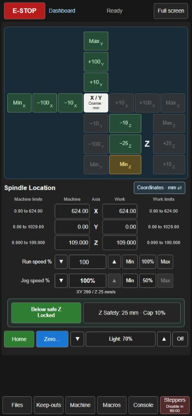
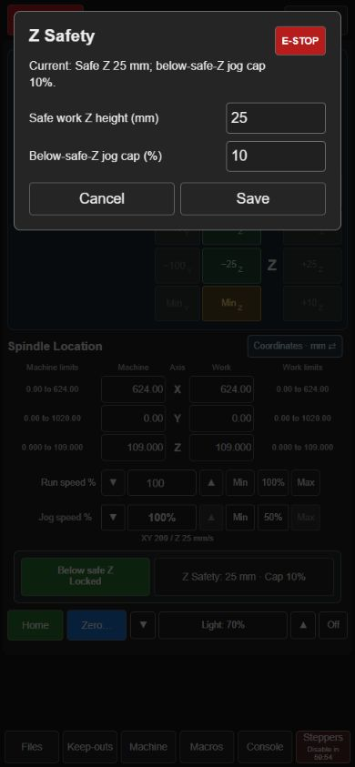

# Mainsail CNC Pendant

**Mainsail CNC optimization — LowRider V4 reference, built for a phone-sized pendant.**

### Your phone becomes your CNC pendant.

**Early developer preview · LowRider V4 reference implementation · Klipper + Moonraker**

A dedicated CNC control page alongside the standard Mainsail dashboard. Set up with a compact jog cross; switch automatically to a job-running screen; return to guarded jogging when paused. Use a PC, Android browser, or the separate Android app.

> **Early days, built through brainstorming and hands-on testing.** Most implementation and documentation were created with **ChatGPT / OpenAI Codex**, guided by the owner's ideas and LowRider testing. Every machine needs individual review and testing. This is not a certified safety system or a universal drop-in CNC conversion.

[Install & recover](docs/SETUP.md) · [Android APK](android/apk/CNC-Pendant-preview.apk) · [Compatibility](docs/COMPATIBILITY.md) · [What persists](docs/PERSISTENCE.md) · [Roadmap](docs/ROADMAP.md)

<table><tr><td width="50%">

</td><td width="50%">

</td></tr></table>

*Live-page captures at a 390 × 844 phone viewport. No machine motion was commanded for these screenshots. The Android app has been installed and used on the reference owner’s phone; other devices need individual testing.*

## Controls built for CNC

- XY jog cross, three-row Z controls and a distinct Coarse/Fine toggle.
- Shared **mm / cm / inch** units; double-tap to switch. Inch jogging uses useful 0.001 / 0.01 / 0.1-inch fine steps, rather than awkward conversions of metric increments.
- Machine limits / editable machine position / axis / editable work position / work limits. **Enter commits; leaving cancels.** Machine-coordinate entries are converted through the current work offset before travel and clearance checks.
- Independent compact **Run speed** and **Jog speed** controls. Run preset shows 50% at current speeds up to 60%, and 100% at 61% or above. 300% Max requires confirmation.
- Safe work-Z permission alongside one **Z Safety** dialog for height and jog-speed cap, with explicit Save/Cancel. The cap limits the selected jog speed rather than replacing it. Relocks above safe height and on origin changes.
- Gray unavailable moves, green normal moves, amber downward destinations below safe work height. Forced recovery uses explicit red controls.
- **IN MOTION — Additional moves will be queued. Proceed with caution.** Uses waiting requests plus controller motion timing; it is not an exact count of Klipper's full queue.
- Home and zero dialogs, idle-stepper warning/snooze/automatic disable, and work-light controls.
- Setup / running / paused views, Pause / ordered Resume and confirmed Abort.
- PC controls centered with a compact menu below; larger single-press E-STOP stays at the far upper-left of the browser window. Android uses the full available width with a compact single-row header and reserved app-gear space. Small windows can scroll instead of shrinking controls.
- Pi-backed shared units, jog preferences, safe height/cap and keep-outs. PC and Android follow the same settings, with remote changes deferred during an edit.

## Browser or Android app

The standard Mainsail dashboard stays available. Open `/cnc-pendant.html` directly or use its sidebar link. The Android app adds a home-screen icon, a dedicated window, configurable machine address, screen-awake behavior, and reconnect/settings controls. It loads the same live page from the Pi; it does not maintain a separate copy of the motion logic.

[Android setup and build instructions](docs/ANDROID.md). The preview APK is supplied for individual testing, not through Google Play. Browser launch support uses an explicit app link; Android may ask you to choose the app.

## Actual G-code verification

Select a file for a quick metadata warning, then stage it for background scanning of its actual G-code. Start and Resume check current work offsets, machine bounds, file fingerprint and reviewed macro profile. Separate analysis files leave original G-code unchanged. Paused X/Y re-zeroing is blocked; a new tool Z zero requires re-verification. Tested P38 files with 9,220–224,482 moves scanned in about 1.5–40 seconds on the reference Pi. Unsupported commands fail closed.

**The full system requires the Moonraker component and Klipper guards; the UI installer alone is insufficient.** See [full-system setup](docs/PREFLIGHT-SETUP.md). Travel verification does not establish fixture clearance.

## Know what the guards cover

The page guards **its own jog and coordinate-entry paths**. Console commands, advanced macros, homing, and G-code programs can bypass those guards. Keep-outs do not rewrite CAM output. Verify the program and workholding independently. Software E-STOP depends on a working host/network/controller path; retain a suitable physical emergency stop.

Klipper buffers timed motion. Releasing a key or stopping a simple scroll-wheel-to-G-code adapter does not necessarily stop already queued travel. That is why these controls favor deliberate step buttons and motion feedback over pretending to be a real-time handwheel. See [Klipper's motion architecture](https://www.klipper3d.org/Code_Overview.html#code-flow-of-a-move-command).

## What is LowRider-specific?

The reference macros assume upward Z homing, X/Y minimum homing, paired Y/Y1 and Z/Z1 motors, and the owner's LED/idle-warning conventions. The browser obtains machine limits and coordinates from Klipper, but currently retains reference macro names and jog-rate defaults. Forced individual-motor recovery is **Cartesian only** and requires its optional Klipper extension. CoreXY, delta and other coupled kinematics must not use single-motor Cartesian recovery.

This repository deliberately excludes printer.cfg, MCU IDs, credentials, backups and personal G-code files. Review [Compatibility](docs/COMPATIBILITY.md) before adapting it. A fully generic profile-driven installer is future work; current installation stages UI assets and keeps machine configuration review explicit.

## Install, test, recover

```sh
python3 tools/manage.py install --mainsail-dir ~/mainsail --config-dir ~/printer_data/config
# Review the dry run and docs/SETUP.md before adding --apply.
```

Installer backs up full machine configuration locally, records hashes of every managed file, and supports conflict-checked uninstall. It does not silently replace your homing, pause, spindle, pins or machine limits. Upstream Mainsail updates may remove the sidebar loader; the standalone pendant files remain independently recoverable.

## Feedback and contributions welcome

I'm a GitHub newcomer. Pull requests, direct feedback, screenshots and reports from other machines are very welcome. Please describe your kinematics, Mainsail/Klipper versions, relevant macros, and what you tested. The goal is a useful, understandable Klipper CNC interface developed openly with users.

Future work includes spindle on/off and RPM, probing/tool workflows, more generic machine profiles, and the next file-selection/pause improvements in [the roadmap](docs/ROADMAP.md).

Independent project; not endorsed by Mainsail, Klipper, Moonraker or V1 Engineering. **GPL-3.0-or-later**; see [LICENSE](LICENSE) and [NOTICE](NOTICE).

## Credits — human + AI collaboration

**ChatGPT / OpenAI Codex carried out most of the software implementation, interface iterations, Android wrapper, G-code verification work, automated tests, and documentation.** [dung-adumbs](https://github.com/dung-adumbs) supplied the CNC workflow, design ideas, priorities, and hands-on LowRider V4 testing. This project grew from a brainstorming conversation into an actively tested CNC pendant.

Credit also belongs to the upstream Mainsail, Klipper, Moonraker and V1 Engineering communities. This is an independent early preview. AI authorship does not replace individual machine review and testing. Contributions, corrections and reports from real machines are welcome.
